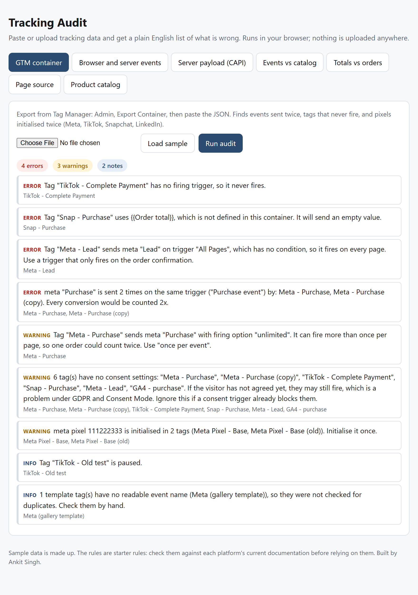
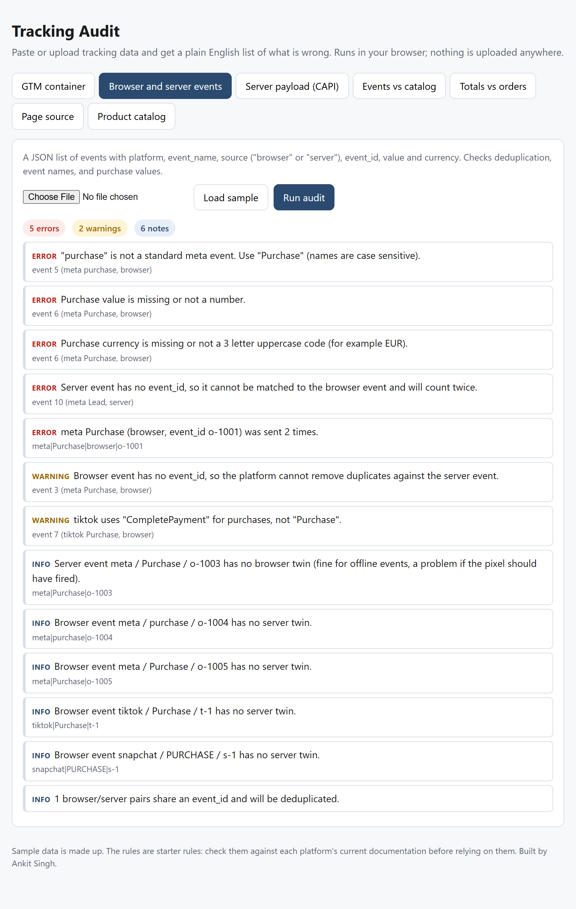
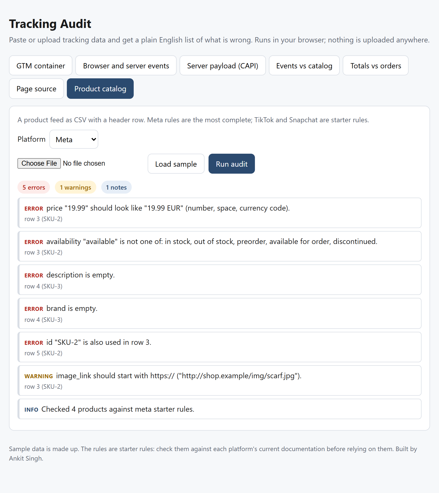
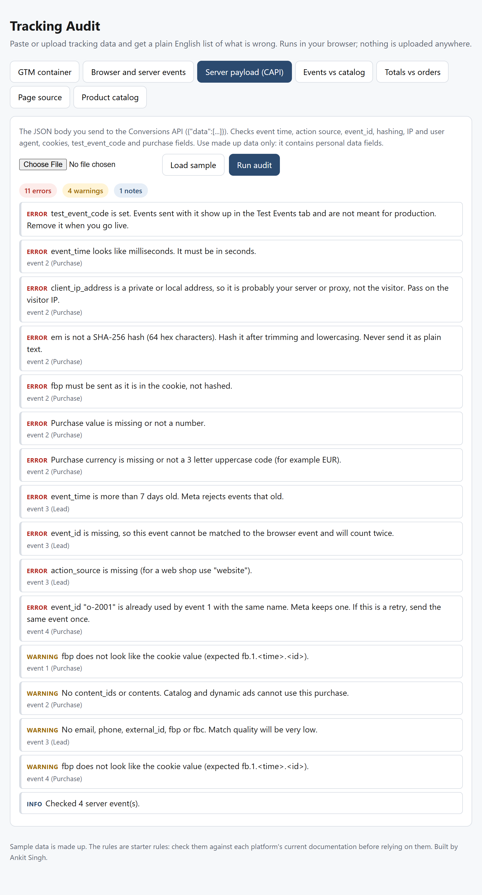
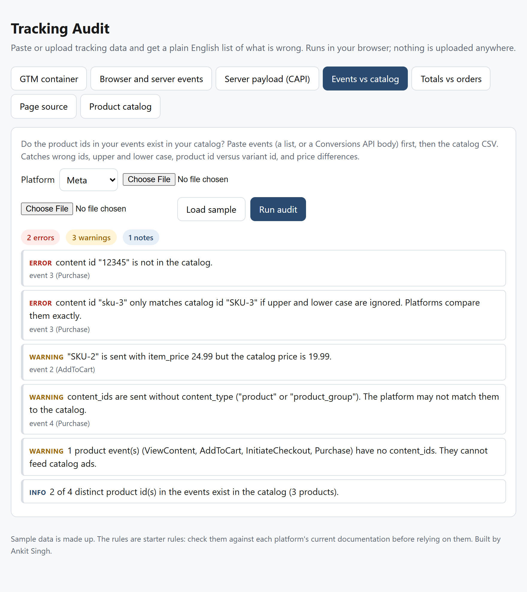
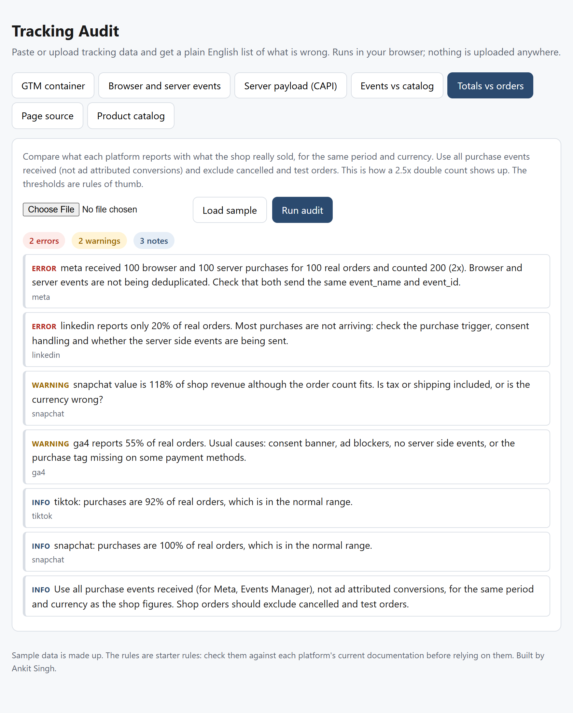
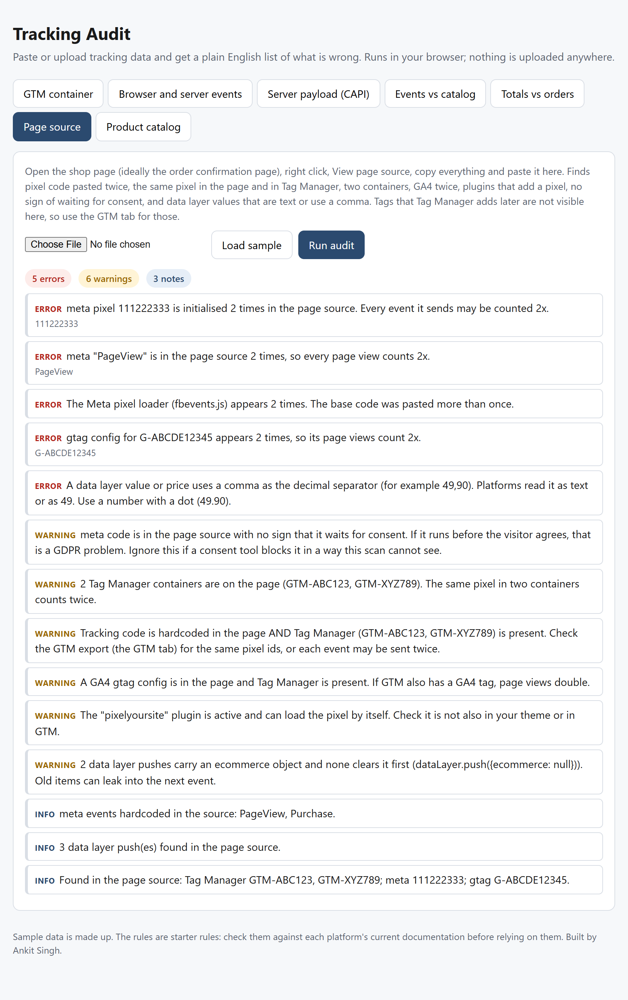

# Tracking Audit

A small browser tool that checks pixel, Conversions API and product catalog setups and lists what is wrong in plain English. Open `index.html`, paste or upload your data, and press **Run audit**. It runs entirely in your browser and uploads nothing.

I built it because the same mistakes keep costing advertisers money: an event sent twice, a server event that cannot be matched to the browser event, a catalog field that quietly gets products rejected. In my work as a technical support advisor for Meta advertisers I set up and checked Pixel, Conversions API and Tag Manager on 100+ shops a month. One shop had two tags counting every purchase, so its results looked about 2.5x better than they were. The first check here is built to catch exactly that pattern.

## What it checks

| Check | Input | Finds |
|---|---|---|
| GTM container | Container export (JSON) | The same event sent twice on one trigger, tags with no trigger or a missing trigger, a pixel initialised twice, paused tags, variables used but not defined, purchase or lead tags on a trigger with no condition (every page), conversion tags with unlimited firing, tags with no consent settings. Reads Meta, TikTok, Snapchat and LinkedIn code, and GA4 and gallery template tags that have an event name parameter |
| Browser and server events | JSON list of events | Missing or duplicate `event_id` (deduplication), server events with no browser twin, non standard event names and wrong case, purchases with a missing or non numeric value or a bad currency |
| Server payload (CAPI) | The JSON body sent to the Conversions API | `event_time` in milliseconds or older than 7 days, missing `event_id` or `action_source`, a repeated `event_id`, plain text or empty-value hashes, hashed `fbp`/`fbc`, a private IP instead of the visitor IP, missing user agent or source URL, `test_event_code` left on, purchase value, currency and `content_ids` |
| Events vs catalog | Events (list or Conversions API body) and the catalog CSV | `content_ids` that are not in the catalog, ids that match only if upper and lower case are ignored, a product id sent where the catalog uses a variant id, ids sent without `content_type`, `item_price` that differs from the catalog price, product events with no ids |
| Totals vs orders | Real order count and revenue, and what each platform reports | A platform reporting more purchases than the shop took (the 2.5x case), browser and server events not deduplicated, far fewer purchases than orders, and a value that does not fit the count (tax or shipping included, zero values). Thresholds are rules of thumb |
| Page source | The shop page HTML (View page source) | Pixel code pasted twice, the same pixel initialised twice, PageView twice, hardcoded pixel and Tag Manager together, two containers or one loaded twice, GA4 config twice, plugins that add a pixel, no sign of waiting for consent, data layer values as text or with a comma, ecommerce object never cleared |
| Product catalog | CSV feed | Missing columns, empty required values, duplicate IDs, prices not in the "19.99 EUR" format, non https links, invalid availability or condition values (Meta) |

## Try it

1. Open `index.html` in a browser (double click works).
2. Pick a tab and press **Load sample**. The samples are made up and each one contains deliberate mistakes.
3. Replace the sample with your own export and run it again.

Run the tests with `node test.js`. They check every rule against the sample data and confirm that clean inputs produce no errors.

## Limits, stated plainly

- **Starter rules.** The rules live in plain tables at the top of `audit.js`. Platform requirements change, so check them against each platform's current documentation before relying on them. Meta is the most complete. TikTok and Snapchat are starter rules. LinkedIn has no product catalog check.
- **Template tags.** Gallery tags that store no readable event name are listed as "not read" instead of passing silently. Field names such as `tagFiringOption` and `consentSettings` are written from memory and the tool has not yet been run on a real container export.
- **Heuristics, not a crawler.** The GTM check reads tag code for `fbq`, `ttq`, `snaptr` and `lintrk` calls. It does not run your site and does not see server side containers.
- **No live platform connection.** It does not read data from Meta, TikTok or any other platform.
- **Made up data only.** Never paste data containing customer information.

## Files

- `index.html`: the page.
- `audit.js`: the checks, with no dependencies. Works in the browser and in Node.
- `samples.js`: synthetic sample data.
- `test.js`: tests.

## Ideas for next

Server side GTM container support, more platform rules, a downloadable report, and a check for Conversions API match quality fields.

Built by [Ankit Singh](https://www.linkedin.com/in/ankit-singh-wpl), with Claude Code. MIT license.
